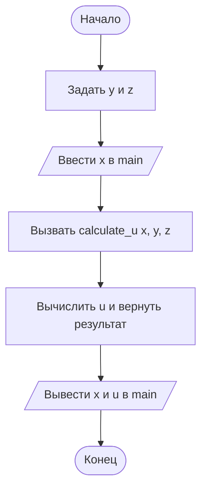

# Домашнее задание к лабораторной работе № 5

## 1. Условие задачи

**Вариант 2.**

Составить структурную схему алгоритма и программу на языке C для вычисления выражения:

$$
u = \frac{\sqrt[3]{8 + |x-y|^2 + 1}}{x^2+y^2+2} - e^{|x-y|}\left(\tan^2 z + 1\right)^x
$$

Значение x вводится пользователем, остальные параметры задаются как константы.

Контрольный пример:

- x = -4,5
- y = 0,75 × 10⁻⁴
- z = 0,845 × 10²
- Ожидаемый результат указан в задании преподавателя.

## 2. Алгоритм и блок-схема

1. В главной функции `main()` задать константы y и z.
2. Ввести значение x в `main()`.
3. Передать x, y и z в функцию `calculate_u()`.
4. В отдельной функции вычислить значение выражения и вернуть результат.
5. Вывести введённое значение x и результат u в `main()`.

Функция `tan()` принимает угол в радианах.



## 3. Реализация программы

Ввод исходного значения выполняется в `main()`. Расчёт выражения вынесен в отдельную функцию `calculate_u()`, которая получает параметры и возвращает вычисленный результат.

```c
#define _CRT_SECURE_NO_DEPRECATE
#include <stdio.h>
#include <locale.h>
#include <math.h>

double calculate_u(double x, double y, double z);

int main()
{
    double x;
    const double y = 0.75e-4;
    const double z = 0.845e2;
    double u;

    setlocale(LC_ALL, "RUS");

    printf("Введите x: ");
    if (scanf("%lf", &x) != 1)
    {
        printf("Ошибка ввода.\\n");
        return 1;
    }

    u = calculate_u(x, y, z);

    printf("x = %.4f\\n", x);
    printf("u = %.4f\\n", u);

    return 0;
}

double calculate_u(double x, double y, double z)
{
    double difference = fabs(x - y);

    return cbrt(8.0 + pow(difference, 2.0) + 1.0)
           / (x * x + y * y + 2.0)
           - exp(difference) * pow(tan(z) * tan(z) + 1.0, x);
}
```

## 4. Результаты работы программы

Для контрольного примера ввести x = -4,5. Константы y и z задаются в программе. Результат вычисляется функцией `calculate_u()`.

## 5. Информация о разработчике

**Хром А. И.**, группа **бИД-261**.
