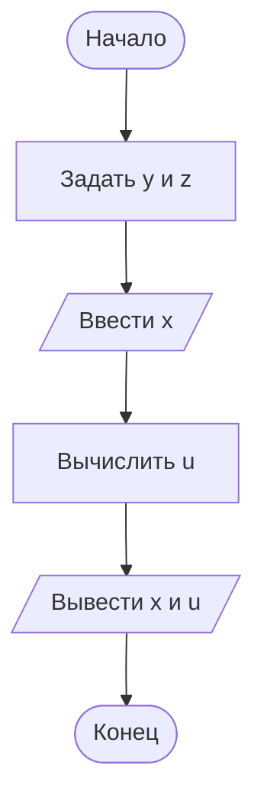

# Домашнее задание к лабораторной работе № 5

## 1. Условие задачи

**Вариант 2.**

Составить структурную схему алгоритма и программу на языке C для вычисления выражения:

$
u = \frac{\sqrt[3]{8 + |x-y|^2 + 1}}{x^2+y^2+2} - e^{|x-y|}\left(\tan^2 z + 1\right)^x
$

Значение (x) вводится пользователем, остальные параметры задаются как константы.

Контрольный пример:

- (x = -4{,}5)
- (y = 0{,}75 \times 10^{-4})
- (z = 0{,}845 \times 10^2)
- Ожидаемый результат: (u \approx -55{,}6848)

## 2. Алгоритм и блок-схема

1. Задать константы (y = 0{,}75 \times 10^{-4}) и (z = 0{,}845 \times 10^2).
2. Ввести значение (x).
3. Вычислить модуль разности (|x-y|).
4. Вычислить значение выражения (u), используя функции стандартной библиотеки.
5. Вывести введённое значение (x) и результат (u).

Функция `tan()` принимает угол в радианах.



## 3. Реализация программы

```c
#include <stdio.h>
#include <math.h>

int main() {
    double x;
    const double y = 0.75e-4;
    const double z = 0.845e2;
    double u;

    printf("Введите x: ");
    scanf("%lf", &x);

    u = pow(8.0 + pow(fabs(x - y), 2.0) + 1.0, 1.0 / 3.0)
        / (x * x + y * y + 2.0)
        - exp(fabs(x - y)) * pow(tan(z) * tan(z) + 1.0, x);

    printf("x = %.4f\n", x);
    printf("u = %.4f\n", u);

    return 0;
}
```

## 4. Результаты работы программы

Контрольный пример: при вводе (x = -4{,}5), программа использует заданные константы (y = 0{,}75 \times 10^{-4}) и (z = 0{,}845 \times 10^2).

```text
Введите x: -4.5
x = -4.5000
u = -55.6848
```

## 5. Информация о разработчике

**Хром А. И.**, группа **бИД-261**.
